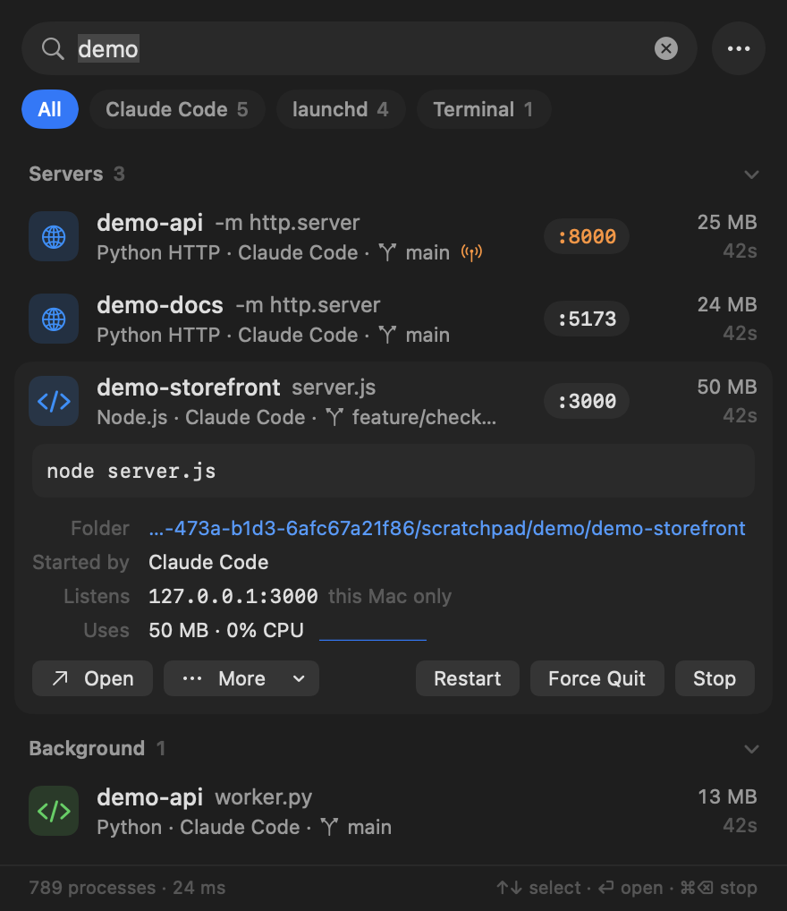

# Bollard

Bollard is a macOS menu bar app that lists every server, script, background job and coding-agent session you've left running, and stops any of them with one click. It's for people who run a lot of local work, much of it started by agents they aren't watching.



## Install

```sh
brew trust --cask fortunexbt/tap/bollard
brew install --cask fortunexbt/tap/bollard
```

Homebrew 7 only loads casks from official taps and taps you trust, so the first command is needed once per machine. You can also download `Bollard-<version>.dmg` from [Releases](https://github.com/fortunexbt/bollard/releases) and drag Bollard to Applications. Releases are signed with a Developer ID and notarised. Bollard needs macOS 26 or later on Apple silicon.

Click the bollard in the menu bar or press ⌃⌥B. The Homebrew cask also puts `bollard` on your path, so `bollard 3000` tells you what owns port 3000 and `bollard --list` prints what the panel shows.

## What it shows

Each row is named after its git repository and shows what it runs (`next dev`, `worker.py`, `-m http.server`), its ports, branch and memory, and who started it, such as Claude Code, Codex, Terminal or launchd. Bollard doesn't match against a list of known programs. Any long-lived process tree of yours appears, a `python -c` one-liner or a compiled binary included, unless it belongs to macOS, to an application, or to a terminal session you're sitting in. An orange port is reachable from your network.

The pills under the search box filter by launcher, and Stop All follows the filter, so stopping everything Claude Code left running takes one menu item.

## Stopping safely

Stop sends SIGTERM and waits four seconds, then tells you what survived and offers Force Quit. Before any signal, Bollard re-reads the whole process tree.

- A reused PID is never signalled. Every signal goes through `proc_signal_with_audittoken` with the identity Bollard recorded, and the stop aborts if a process's command or owner has changed.
- Bollard leaves launchd, itself, other users' processes, macOS system paths, terminals, editors, login sessions and interactive shells out of every stop, along with everything under them.
- Ending an agent session leaves the servers that agent launched running. `bollard --stop <name>` never matches an agent session, and the MCP server can't end one.
- When a stop may not stick, for example a launchd job that will restart, the row warns you instead of refusing.

Bollard makes no network requests, sends no telemetry, has no runtime dependencies and installs no privileged helper. Like `lsof`, it can only see sockets owned by your own processes.

## For agents

`bollard --mcp` is a Model Context Protocol server over stdio. Its tools list what's running, name a port's owner, stop a server, return a free port and wait for a port to open or close, so an agent doesn't have to guess with `lsof`, `kill` and `sleep`.

```sh
claude mcp add -s user bollard -- /Applications/Bollard.app/Contents/MacOS/Bollard --mcp
```

`bollard --json` gives scripts the same rows in a stable shape.

## Building

```sh
./scripts/build.sh && ./scripts/install.sh
```

This needs the Xcode command-line tools. It installs into `/Applications` and links the command to `~/.local/bin/bollard`. Run `swift build && .build/debug/BollardChecks` for the checks.

## More

- [Reference](docs/reference.md) has the shortcuts, CLI flags, JSON fields, controller scripts and discovery internals.
- [Performance](docs/performance/README.md) has scan timings. A steady scan takes about 9 ms with 790 processes.
- [Verification](VERIFICATION.md) records what was tested for 3.0.0, gaps included, and the [changelog](CHANGELOG.md) covers each version.

Bollard is released under the [MIT licence](LICENSE).
